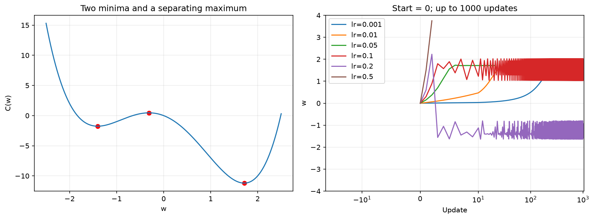
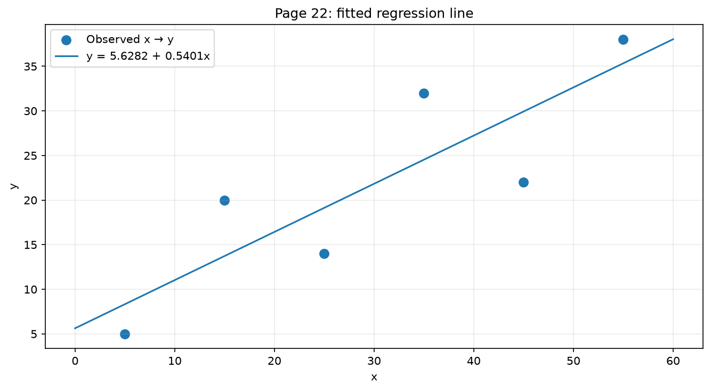
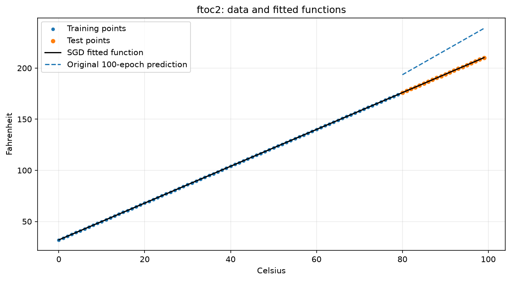
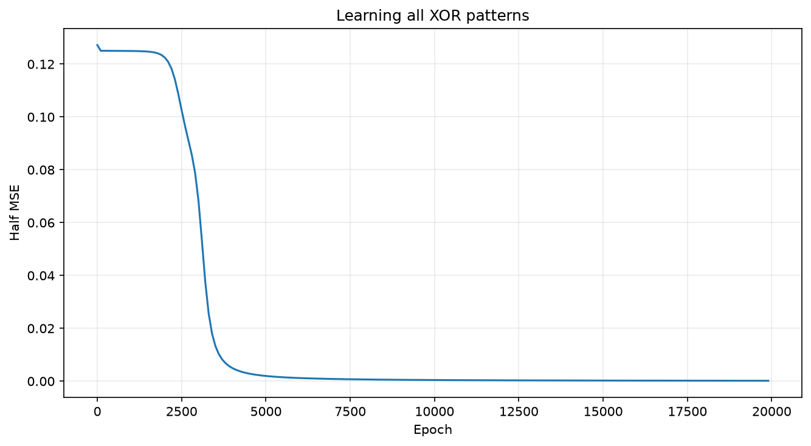
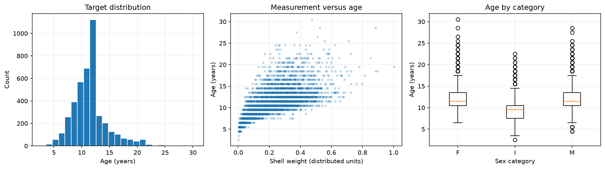
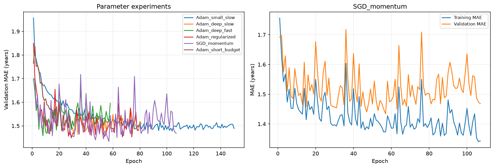
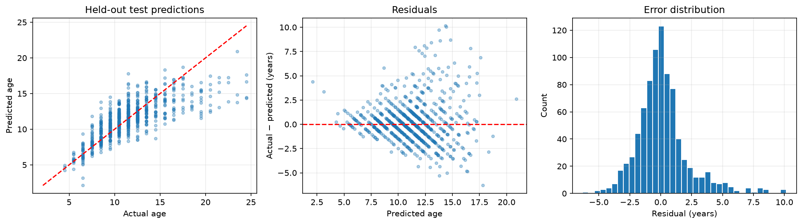

# Advanced AI methods

Regression, artificial neural networks and the network learning algorithm.

**Student:** Rinkle Sharma  
**Student ID:** 67784

This project completes the seven exercises in the Python/PyTorch version of the assignment. It starts with gradient descent and the lecture's regression example, checks a backpropagation step by hand, demonstrates tensor operations, and trains neural networks for XOR and a real regression dataset.

The real-data model predicts abalone age from physical measurements. On 836 held-out observations, the selected network achieved **MAE 1.4653 years**, **MSE 4.5262 years²**, and **MAPE 12.23%**.

## Start here

- [PDF report](Assignment_Report.pdf): the written explanation, tables, figures and references, with the student's name and ID.
- [Completed notebook](Neural_Networks_Completed.ipynb): all seven tasks, executable code, saved outputs and ten plots. GitHub can preview it; download it to run it.
- [Complete download package](Neural_Networks_Assignment.zip): the report, notebooks, data and supporting results together.
- [Original temperature example, executed](ftoc2_original_executed.ipynb): the supplied `ftoc2.ipynb` code, retained unchanged, with executed outputs and additional setup/result cells.

This repository uses the main Python option. The KNIME workflow, MLP Learner/Predictor nodes and KNIME screenshot belong to the assignment's alternative option and are not included here.

## Run the project

### Google Colab

1. Open [Google Colab](https://colab.research.google.com/).
2. Upload `Neural_Networks_Completed.ipynb`.
3. Choose **Runtime → Run all**.

The notebook uses CPU PyTorch; a GPU is not required. If `data/abalone.data` is absent, the notebook downloads the UCI archive automatically. Its plots and result files are written to the current working directory. In Colab, download any generated files you want to keep before closing the session.

### Local Python on Windows

Clone the repository and create a virtual environment:

```powershell
git clone https://github.com/megamind294/Advanced-AI-methods.git
cd Advanced-AI-methods
python -m venv .venv
```

Install the libraries and a notebook interface:

```powershell
.\.venv\Scripts\python.exe -m pip install --upgrade pip
.\.venv\Scripts\python.exe -m pip install -r requirements.txt notebook
.\.venv\Scripts\python.exe -m ipykernel install --user --name advanced-ai-methods --display-name "Advanced AI methods"
.\.venv\Scripts\python.exe -m notebook Neural_Networks_Completed.ipynb
```

Select the **Advanced AI methods** kernel and run all cells from top to bottom. Keep the working directory at the repository root so the notebook uses the included `data/` folder. The executed notebook already contains the results, so you can read it without rerunning training.

To run the slide-35 example as a normal Python program:

```powershell
.\.venv\Scripts\python.exe train_xor.py
```

On macOS/Linux, use `.venv/bin/python` in place of `.\.venv\Scripts\python.exe`.

For a noninteractive notebook run, after registering the kernel above:

```powershell
.\.venv\Scripts\python.exe -m nbconvert --to notebook --execute Neural_Networks_Completed.ipynb --output Neural_Networks_Completed_rerun.ipynb --ExecutePreprocessor.kernel_name=advanced-ai-methods --ExecutePreprocessor.timeout=900
```

`requirements.txt` gives portable minimum versions. `requirements-lock.txt` records the versions used for the saved run. Its PyTorch version has a `+cpu` suffix; that exact build requires the corresponding PyTorch CPU wheel index. The ordinary requirements file is the simpler installation route. Training was executed locally on Windows using Python 3.12, CPU PyTorch and one Torch thread.

## 1. Gradient descent: the lecture example

For a loss function $C(w)$, a gradient-descent update is

$$w_{t+1}=w_t-\eta C'(w_t),$$

where $\eta$ is the learning rate.

For $C(w)=w^2$, the derivative is $2w$. Starting at $w=10$ with learning rate 0.2 gives

$$w_{t+1}=0.6w_t.$$

After ten updates, the result is **0.060466176**, which agrees with $10(0.6)^{10}$. The notebook prints each step and plots the decreasing weight.

The lecture labels its exact-gradient examples SGD. More precisely, these are deterministic gradient descent or full-batch gradient descent. True stochastic gradient descent estimates the gradient from sampled observations. The notebook also implements a shuffled, single-observation SGD regression example to show the distinction. An epoch in that example consists of six weight updates.

## 2. A nonconvex function and learning-rate experiments

The required function is

$$C(w)=w^4-5w^2-3w,$$

with

$$C'(w)=4w^3-10w-3,\qquad C''(w)=12w^2-10.$$

The notebook solves for the stationary points and uses the second derivative to classify the minima and maximum. It then runs all **54 combinations** of:

| Parameter | Values |
|---|---|
| Initial weight | −2, 0, 2 |
| Learning rate | 0.001, 0.01, 0.05, 0.1, 0.2, 0.5 |
| Iteration limit | 10, 100, 1000 |

The final weight, objective value, gradient magnitude, update count and stopping status are saved in [quartic_experiments.csv](quartic_experiments.csv).

Starting from zero, a small learning rate makes slow progress. Rates of 0.01 and 0.05 approach the minimum sooner, while 0.1 produces persistent oscillations and 0.5 diverges. More iterations help a stable run that has not converged; they cannot fix an unstable rate. Because the function has two minima, initialization matters too. A small proposed update alone is not proof of convergence when the rate is tiny, so gradient magnitude is reported separately.



## 3. Linear regression and the temperature example

### Six lecture observations

The lecture uses these points:

| x | 5 | 15 | 25 | 35 | 45 | 55 |
|---|---:|---:|---:|---:|---:|---:|
| y | 5 | 20 | 14 | 32 | 22 | 38 |

For residual $r_i=w_0+w_1x_i-y_i$, the optimized loss and its gradient are

$$L=\frac{1}{2n}\sum_i r_i^2,$$

$$\nabla L=\left[\operatorname{mean}(r),\operatorname{mean}(rx)\right].$$

Starting at `[0.5, 0.5]` with learning rate 0.0008 and up to 100,000 updates gives

$$\hat y=5.628223+0.540129x.$$

The coefficients are checked against NumPy's exact least-squares solution. Their small difference comes from the gradient-descent stopping tolerance. These six observations are all used for fitting, so this example reports training error rather than a generalization estimate.



### Celsius to Fahrenheit: `ftoc2.ipynb`

The supplied example creates Celsius values 0–99 and uses the known relationship $F=1.8C+32$. The first 80 observations are training data; the last 20 test extrapolation to the upper temperature range.

The original active settings are **Adam**, learning rate **0.02**, **MAE loss** and **100 epochs**. Its SGD code is commented out. The repository includes a separately executed copy of this original code.

The completed notebook adds a separate SGD fit, dividing inputs by 100 and outputs by 200 to improve conditioning. It uses MSE loss, learning rate 0.1 and 5000 epochs. Converting the learned coefficients back gives

$$\hat F=1.799994C+32.000241.$$

This closely matches the exact conversion. The data are synthetic and noiseless, so the result should not be interpreted as evidence of performance on a real prediction problem. Several settings change together between the two runs, so the comparison does not isolate optimizer effects.



## 4. Manual forward pass and backpropagation

The calculation uses the lecture's two-input, two-hidden-neuron sigmoid network with different initial weights. The learning rate is 0.2, the input is `[1, 0]`, and the target is 1. A constant bias input is included as $u_0=1$.

The hidden weight rows, written `[bias, input 1, input 2]`, are

```text
Neuron 3: [ 0.1, 0.2, -0.3]
Neuron 4: [-0.2, 0.4,  0.1]
```

The output row, written `[bias, hidden 3, hidden 4]`, is `[-0.1, 0.3, -0.2]`.

The forward pass gives hidden sums $S_3=0.3$ and $S_4=0.2$. Each activation uses $\sigma(S)=1/(1+e^{-S})$. For half-squared loss, the error terms are

$$\delta_5=(C-u_5)u_5(1-u_5),$$

$$\delta_j=\delta_5w_{5j}u_j(1-u_j),\quad j\in\{3,4\}.$$

Each connection is updated using

$$w_{ji}^{new}=w_{ji}+\eta\delta_j u_i.$$

Here $u_i$ is the **source** activation, and it is 1 for a bias connection. All deltas use the old weights. After all updates, the forward pass is calculated again.

| Response | Value |
|---|---:|
| Before the update | 0.490592599 |
| After the update | 0.501082446 |

The updated response moves toward target 1 and reduces the loss. Weights attached to input 2 do not change because that input is zero. The notebook shows all weighted sums, activations, derivatives, deltas and **nine weight updates**. The NumPy calculations are independently checked against PyTorch autograd.

The lecture's page-36 bias formula has a typographical inconsistency: its bias update must use the constant input 1. The numerical implementation uses that correct rule.

## 5. Tensor operations and dimensions

The examples use new values to demonstrate addition, subtraction, multiplication, division and matrix multiplication. Elementwise `*` and matrix multiplication `@` perform different operations.

| Method | What the example demonstrates |
|---|---|
| `reshape` | Changes the shape while preserving element count; may copy if needed. |
| `view` | Returns a compatible view that shares storage with the source. |
| `stack` | Joins equally shaped tensors along a newly added dimension. |
| `squeeze` | Removes a size-one dimension. |
| `unsqueeze` | Inserts a size-one dimension at a chosen position. |
| `permute` | Reorders axes, such as HWC to CHW. |

The notebook prints the resulting shapes, dimension counts and element counts. It also changes a value through a view to demonstrate shared storage, then uses a transposed tensor to show why incompatible strides can make `view` fail. The dimensionality table is on **PDF page 46**, following arithmetic on page 45.

## 6. Reproduce and train the XOR network in PyTorch

### Exact slide-35 update

[`train_xor.py`](train_xor.py) and the completed notebook reproduce the lecture's initial weights:

```text
Hidden input weights: [[2, 3], [4, 5]]
Hidden biases:         [1, -2]
Output weights:        [[2, 3]]
Output bias:           [-4]
```

The sample is `[1, 0]`, target 1, with sigmoid activations, half-squared loss and SGD learning rate 0.2. The program performs the forward pass, clears gradients, backpropagates the loss, updates the weights and calculates the new response.

| Quantity | Before | After one update |
|---|---:|---:|
| Network response | 0.633564545 | 0.644935592 |
| Half-squared error | 0.067137471 | 0.063035367 |

Every updated weight is checked against the independent NumPy calculation in the notebook.

### All four XOR patterns

A separate experiment starts a fresh 2–2–1 network with seed 7 and trains on the complete XOR truth table. Full-batch SGD uses learning rate 1 and 20,000 epochs. With a threshold of 0.5, all four training patterns are classified correctly. This is a truth-table demonstration, not an evaluation on unseen data.



## 7. Real-data regression: UCI Abalone

### Prediction problem and data

The [UCI Abalone dataset](https://archive.ics.uci.edu/dataset/1/abalone) contains **4177 observations** and **8 predictors**. Counting shell rings is used to estimate age; the task here is to predict age from easier physical measurements.

The target is **age in years = Rings + 1.5**, following the repository's definition. `Rings` is excluded from the predictors because it directly determines the target.

The inputs are the categorical `Sex` variable (F, M or I, meaning infant) and seven numeric measurements: length, diameter, height, whole weight, shucked weight, viscera weight and shell weight. The numeric values are used in their distributed units; UCI notes scaling in the original preparation.



### Preparation and evaluation design

1. Load the included, headerless `data/abalone.data` with explicit column names.
2. Convert numeric columns using `pd.to_numeric` and check missing values and duplicate rows.
3. Treat nonpositive heights as missing. The original distributed file has no missing entries; artificial missing values are not injected.
4. Make a fixed 60/20/20 train/validation/test split using seed 42: **2505 training**, **836 validation** and **836 test** observations.
5. Fit median numeric imputation, categorical imputation, one-hot encoding and numeric standardization on the training data only.
6. Standardize the training target and invert its scaling before reporting errors in years.

One-hot encoding produces three category indicators. Together with the seven numeric features, the prepared network has **10 input features**. Standardization is the normalization method used here; min-max scaling is not required for the Python option. Validation and test observations do not contribute imputation or scaling statistics.

### Network and hyperparameters

The selected model is a fully connected MLP with this architecture:

```text
10 inputs → Linear(10, 64) → ReLU
          → Linear(64, 32) → ReLU
          → Linear(32, 1)  → predicted standardized age
```

The output is linear because this is regression. Training minimizes MSE on standardized targets. Model selection uses **validation MAE**, measured in years.

| Setting | Selected value |
|---|---|
| Optimizer | SGD |
| Learning rate | 0.03 |
| Momentum | 0.9 |
| Weight decay | 0.001 |
| Minibatch size | 128 |
| Maximum epochs | 400 |
| Early-stopping patience | 50 epochs |
| Best checkpoint | Epoch 57 |
| Actual stopping epoch | 107 |
| Validation MAE at best checkpoint | 1.4338 years |

The selected checkpoint is restored before test evaluation. The model is not retrained using the validation targets after selection.

### Parameter experiments

Six configurations vary layer width/depth, learning rate, optimizer, weight decay and epoch budget. Full settings and metrics are saved in [validation_experiments.csv](validation_experiments.csv).

| Configuration | Hidden widths | Learning rate | Best epoch | Validation MAE |
|---|---|---:|---:|---:|
| SGD with momentum | 64, 32 | 0.03 | 57 | 1.4338 |
| Adam with weight decay | 64, 32 | 0.003 | 29 | 1.4491 |
| Adam, higher learning rate | 64, 32 | 0.01 | 8 | 1.4579 |
| Adam, two hidden layers | 64, 32 | 0.001 | 31 | 1.4627 |
| Adam, small network | 32 | 0.001 | 104 | 1.4779 |
| Adam, 30-epoch limit | 64, 32 | 0.001 | 22 | 1.4797 |

The higher Adam rate reaches its best score early. Training longer is useful only while validation performance improves. The curves also show why the last epoch should not automatically be used as the final model. These are comparisons of complete configurations; when multiple settings change, their separate effects cannot be inferred from that comparison alone.



### Held-out test results

The chosen model is evaluated on the untouched test set after selection. A training-mean dummy model and Ridge regression provide baselines.

| Model | MAE (years) | MSE (years²) | RMSE (years) | MAPE (%) | R² |
|---|---:|---:|---:|---:|---:|
| Training-mean baseline | 2.3851 | 10.8357 | 3.2918 | 22.71 | −0.0010 |
| Ridge, alpha = 1 | 1.6188 | 4.9551 | 2.2260 | 13.98 | 0.5423 |
| Selected neural network | **1.4653** | **4.5262** | **2.1275** | **12.23** | **0.5819** |

MAE is the average absolute error. MSE penalizes large errors more strongly and is measured in years squared; RMSE returns to years. MAPE is `100 × mean(abs(actual − predicted) / abs(actual))`. Every age is positive, so its denominator is nonzero. R² compares squared error with prediction of the evaluation set's mean; it is not classification accuracy.

The network outperforms both baselines on these test metrics. Its MAE is about **38.6% lower** than the training-mean baseline. [test_predictions.csv](test_predictions.csv) records source row indices, actual ages, predicted ages and residuals. [test_metrics.csv](test_metrics.csv) contains the full-precision evaluation table.



Older animals tend to be underestimated, and the dataset contains fewer examples at those ages. Measurements alone do not determine age exactly. Results come from one historical dataset, one split and one seed. Repeated cross-validation and data from another site would give a stronger assessment of reliability. The best configuration here means the best validation MAE among the six tested settings; it is not a claim of a globally optimal model or a guaranteed grade.

## Files in this repository

| File or folder | Purpose |
|---|---|
| `README.md` | Project explanation, run instructions, results and references. |
| `Assignment_Report.pdf` | Formatted six-page coursework report, including six figures. |
| `Assignment_Report.md` | Editable text source for the report. |
| `Neural_Networks_Completed.ipynb` | All seven exercises, with executed outputs and ten embedded plots. |
| `Neural_Networks_Completed.html` | Downloadable browser-readable export of the completed notebook. |
| `ftoc2_original_executed.ipynb` | Executed copy of the original temperature example. |
| `ftoc2_original_executed.html` | Downloadable HTML export of that original example. |
| `train_xor.py` | Standalone program for one exact slide-35 SGD update. |
| `data/abalone.data` | Original UCI observations, included for offline reruns. |
| `data/abalone.names` | Original dataset description. |
| `data/SOURCE.md` | Source URLs, creator attribution and data license. |
| `figures/` | Ten saved PNG plots from the completed notebook. |
| `quartic_experiments.csv` | 54 polynomial optimization runs. |
| `validation_experiments.csv` | Neural-network settings, best epochs and validation metrics. |
| `test_metrics.csv` | Test scores for the selected model and baselines. |
| `test_predictions.csv` | Predictions and residuals for all 836 test observations. |
| `results_summary.json` | Main numerical results in a machine-readable format. |
| `abalone_model.pt` | Selected PyTorch state dictionary, hidden widths and target scaling. |
| `abalone_preprocessor.joblib` | Fitted feature preprocessing pipeline. |
| `requirements.txt` | Portable minimum dependencies. |
| `requirements-lock.txt` | Exact library versions from the tested environment. |
| `Neural_Networks_Assignment.zip` | Download package containing the assignment deliverables. |

The HTML files must be downloaded and opened locally; GitHub normally displays their source. Notebook reruns regenerate the figures, results tables, model and preprocessor. The PDF and ZIP are prebuilt deliverables. An extra file named `Neural_Networks_Completed_rerun.ipynb` is created only if you use the optional nbconvert command above. The ZIP is the coursework package; this expanded repository README is available separately here on GitHub.

The saved checkpoint is a dictionary, not a directly callable network. Reuse requires rebuilding the listed architecture, loading `state_dict`, applying `abalone_preprocessor.joblib` to the same eight raw predictors, and undoing target scaling with `target_mean` and `target_std` from the checkpoint. The main notebook shows the full preprocessing, architecture and prediction implementation.

## Verification and reproducibility

Both notebooks and the standalone XOR program were run locally. The completed notebook contains **14 executed, nonempty code cells and 10 plots**; the original example contains **9 executed, nonempty code cells and 12 plots**. Neither notebook contains execution errors. Empty source cells in the original notebook are excluded from these counts.

Checks include the quadratic's analytic result, agreement with least squares, agreement between manual backpropagation and autograd, the exact lecture weight update, all four XOR predictions, disjoint data splits, finite prepared data and finite test predictions. MAE, MSE and MAPE were also independently recomputed from the saved test prediction CSV.

Seeds are 42 except the full XOR training run, which uses 7. Minibatch shuffling is seeded. Small numerical differences can occur across library versions or hardware. The main notebook prints the data file's SHA-256 checksum to identify the exact input file.

## References and data attribution

- Course slides: `NN_English.pdf`, pages 19–24, 34–36 and 43–46. The course PDF is referenced but is not redistributed in this repository.
- Supplied course notebook: `ftoc2.ipynb`; its original code is preserved in the executed copy.
- [UCI Abalone dataset](https://archive.ics.uci.edu/dataset/1/abalone), [DOI: 10.24432/C55C7W](https://doi.org/10.24432/C55C7W), retrieved 24 October 2026.
- Dataset creators: Warwick Nash, Tracy Sellers, Simon Talbot, Andrew Cawthorn and Wes Ford.
- Dataset license: [Creative Commons Attribution 4.0 International](https://creativecommons.org/licenses/by/4.0/). Original data files are included unchanged; the notebook applies the height-validity rule in memory and derives age from ring count.
